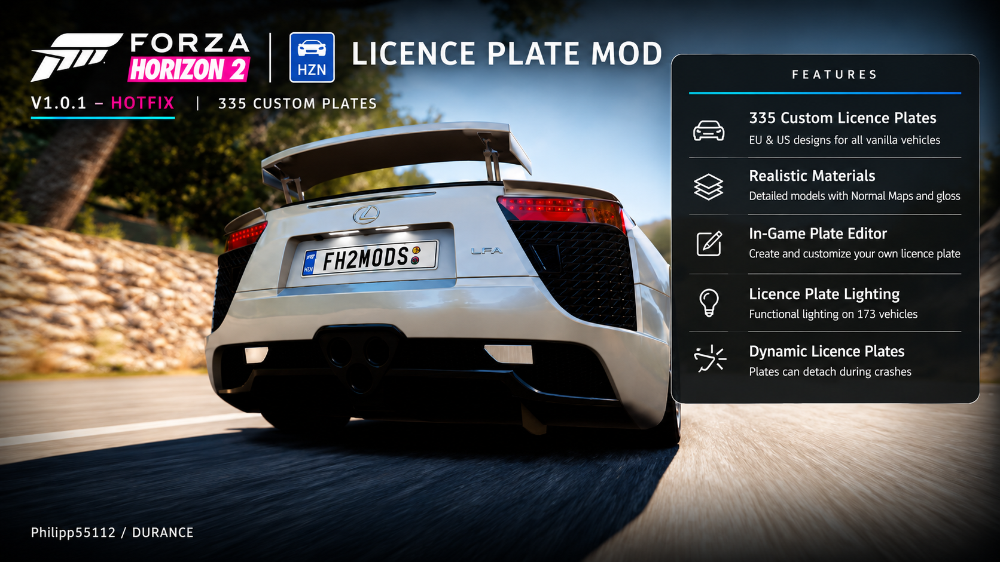

  

  <b>Custom Licence Plates for Forza Horizon 2 on PC</b>

  
  
  
  

# Forza Horizon 2 – Licence Plate Mod

Bring custom licence plates, realistic lighting and interactive customization to Forza Horizon 2!

The Licence Plate Mod completely overhauls the licence plates of **335 vanilla vehicles**, introducing custom HORIZON designs, an integrated in-game editor, functional licence plate lighting and dynamic plates that can detach during crashes.

Give your own vehicle a unique identity while keeping the original HORIZON appearance for Drivatars and traffic.

---

> ⚠️ **Loading Time Notice**
>
> The first launch may take slightly longer than usual. Loading times may also be temporarily increased after changing your licence plate. Once you leave the Garage, subsequent loading times should return to normal.

---

## ✨ Features

### 🚗 Custom Licence Plates

- Custom HORIZON licence plate models for **335 vanilla vehicles**.
- European and US-style licence plate designs, selected to match each vehicle.
- Realistic embossed lettering using Normal Maps.
- Detailed gloss maps and individual licence plate materials.
- Custom licence plates exclusive to the player's vehicle.
- Drivatars and traffic retain their standard HORIZON licence plates.
- Your custom plate remains assigned to your vehicle when changing cars.
- Works even when a Drivatar is driving the same vehicle model as you.
- Dedicated player vehicle resources prevent unnecessary additional texture usage.

### 🖥️ In-Game Licence Plate Editor

Customize your licence plate directly from the Garage.

- Dedicated **Licence Plates** tile in the Garage.
- Up to 8 characters per licence plate.
- Supports A–Z, 0–9 and spaces.
- Live updates directly on your vehicle while editing.
- Three European-themed plate stickers:
  - Blue
  - Turquoise
  - Gold
- Remove your licence plate directly from the editor.
- Restore the default HORIZON design at any time.
- Interface available in **16 languages**.

### 💡 Licence Plate Lighting

Functional licence plate lighting is implemented for **173 vehicles**.

- Individually positioned light sources for each licence plate lamp.
- Illuminated lamp lenses that activate with the vehicle's headlights.
- Vehicle-specific light colours, brightness and positioning.
- Individual light cones aimed directly at the licence plate.
- Light cone width adapts to the size of the original lamp.
- Supports different tuning bumpers and their respective lamp positions.
- Automatically detects the currently installed bumper.
- Lighting follows the vehicle's headlights, including headlights activated through Extra Options.

Only vehicles with actual, externally visible licence plate lights receive this feature.

### 💥 Dynamic Licence Plates

Licence plates can physically detach during crashes!

- Works with both **Cosmetic** and **Simulation** damage.
- Plates detach when the configured damage threshold is reached.
- Realistic physics: detached plates tumble and fall onto the road.
- The licence plate shadow disappears when the plate is detached.
- Automatically restored after repairing your vehicle.
- Only affects your own vehicle.

---

## 🚙 Vehicle Coverage

| Feature | Coverage |
|---|---:|
| Custom HORIZON licence plates | 335 vehicles |
| Functional licence plate lighting | 173 vehicles |
| EU-style designs | Available |
| US-style designs | Available |
| Custom player licence plates | Fully supported |

All vehicle placements and model integrations have been individually adjusted and visually checked.

Vehicles without a suitable original licence plate mounting position cannot use the corresponding feature.

---

## 🔌 FH2 Mod Platform Compatibility

Licence Plates now supports the **FH2 Mod Platform (`fh2-mods`)** through the optional `LicencePlatesBridge.dll`.

When installed, the bridge creates the required game hooks through the platform and shares them with other platform-compatible mods.

### Supported Mods

- Underglow
- NitroSystem
- ANNA
- Deform
- Police Lightbars
- Autovista Layer

This resolves hook conflicts that could previously prevent multiple mods from working together, including errors such as:

- Some hooks were refused.
- This isn't the FH2 build Underglow knows.

**Important:** The bridge is only required when using the FH2 Mod Platform. Standalone users do not need to install it.

Without the platform, Licence Plates continues to work as usual.

---

## 📦 Requirements

- Forza Horizon 2 – PC version
- Azimuth
- FH2 Extra Options
- Runtime mod loading enabled

**Optional:**
- FH2 Mod Platform (`fh2-mods`) – required only when using `LicencePlatesBridge.dll` for platform integration.

---

## 📥 Installation

### Standard Installation

1. Download the latest release from the GitHub Releases page.
2. Extract the ZIP archive.
3. Copy the `LicencePlates` folder into:

   `mods\Forza Horizon 2\`

4. Make sure runtime mod loading is enabled in Extra Options.
5. Launch the game.

### FH2 Mod Platform Installation

If you are using the FH2 Mod Platform:

1. Follow the standard installation steps.
2. Copy `LicencePlatesBridge.dll` into your:

   `fh2-mods\`

3. Launch the game.

The bridge is not required for standalone installations.

### Updating

When updating an existing installation:

1. Replace your existing `LicencePlates` folder with the new version.
2. Keep a backup of your existing `plugins\PlateLight.ini`.
3. Restore your previous INI file if you want to preserve your custom plate text and lighting settings.

**Note:** Do not overwrite your existing configuration without making a backup first.

---

## ⚙️ Configuration

All configuration options are located in:

`plugins\PlateLight.ini`

### Licence Plate Lighting

The `[Light]` section controls the licence plate lighting.

| Setting | Default | Description |
|---|---:|---|
| `On` | `1` | Enables or disables licence plate lighting. |
| `OnlyWithHeadlights` | `1` | Lighting follows the vehicle headlights. |
| `Brightness` | `0.45` | Overall light brightness. |
| `R` | `1.0` | Red light component. |
| `G` | `0.92` | Green light component. |
| `B` | `0.78` | Blue light component. |
| `Power` | `5.0` | Light intensity. |
| `Inner` | `50` | Inner beam angle in degrees. |
| `Outer` | `100` | Outer beam angle in degrees. |
| `RangeScale` | `1.15` | Controls light range relative to the licence plate. |
| `Out` | `0.015` | Distance of the light source from the lamp lens. |
| `Tilt` | `0` | Additional light beam tilt. |
| `UseTable` | `1` | Uses vehicle-specific lamp data. |
| `ConeByLampSize` | `1` | Adjusts beam width according to lamp size. |

### Licence Plate Settings

The `[Plate]` section controls the licence plate appearance.

| Setting | Default | Description |
|---|---|---|
| `Text` | `HORIZON{0}` | Default licence plate text. |
| `Hidden` | `0` | Set to `1` to hide the licence plate. |
| `FallOffAt` | `0.3` | Damage threshold for physical plate detachment. Set to `0` to disable detachment. |

The in-game editor manages your custom licence plate text automatically.

Changes to the INI-based plate text take effect after restarting the game.

### Editor Settings

The `[Editor]` section includes the following option:

| Setting | Description |
|---|---|
| `OwnPlayerPlate` | Enables or disables the separate custom licence plate for your own vehicle. |

Example:

~~~ini
[Editor]
OwnPlayerPlate=0
~~~

- `1` – Enables the separate custom licence plate for your vehicle.
- `0` – Disables the separate player plate and uses the standard HORIZON plate instead.

Disabling this option also prevents the Garage editor preview from updating on your vehicle.

This option can be used as a fallback if you encounter loading problems.

---

## ⚠️ Known Limitations

- Drivatars display the illuminated licence plate lamp lenses, but only your own vehicle produces actual licence plate lighting.
- Only your own vehicle supports physical licence plate detachment.
- The background lookup for licence plate detachment can take up to approximately 20 seconds after loading a vehicle.
- Vehicles without suitable original licence plate mounting points or visible lamps cannot use the corresponding features.
- A game hang when leaving Photo Mode is a known issue currently under investigation.

---

## 🛠️ Technical Details

The mod consists of custom vehicle assets, UI files and the `PlateLight.dll` plugin.

### Main Components

| Component | Purpose |
|---|---|
| `LicencePlates` | Main mod folder containing the required game assets and plugin files. |
| `PlateLight.dll` | Handles lighting, editor integration, player vehicle detection and dynamic plates. |
| `PlateLight.ini` | Configuration settings. |
| `PlateEditor_eu.bin` / `PlateEditor_us.bin` | Data used to generate custom licence plates. |
| `PlateLightCars.csv` | Vehicle-specific lighting positions. |
| `PlateLightIds.csv` | Vehicle names and identifiers. |
| `PlateLightVariants.csv` | Lighting offsets for tuning variants. |
| `PlateParts.csv` | Maps tuning parts to their respective licence plate models. |
| `PlateHide.csv` | Data for licence plate removal and detachment. |
| `PlateLampSize.csv` | Individual lamp sizes used for light cone calculations. |
| `LicencePlatesBridge.dll` | Optional FH2 Mod Platform integration. |

### Runtime Behaviour

- Custom plate textures are generated at runtime.
- Vehicle-specific plate resources are managed individually.
- Temporary generated files are stored in `plugins\PlateEditor\`.
- Vehicle aliases are reused and overwritten instead of creating unlimited copies.
- The player vehicle is identified separately from Drivatar vehicles.
- Installed tuning parts are detected to determine the correct licence plate and lighting positions.

---

## 🔄 Changelog

### v1.0.1 – Hotfix

**Fixes**
- Fixed an endless loading screen after pressing A on the title screen with FH2 Extra Options 0.6.1.
- Fixed licence plate model lookup by correctly serving the required files from the `LicencePlates` folder.
- Improved player vehicle detection across different setups.

**FH2 Mod Platform Support**
- Added `LicencePlatesBridge.dll`.
- Game hooks are now created through the FH2 Mod Platform when the bridge is installed.
- Improved compatibility with Underglow, NitroSystem, ANNA, Deform, Police Lightbars and Autovista Layer.

**New Configuration Option**
- Added `OwnPlayerPlate=0` under `[Editor]` in `PlateLight.ini` to disable the separate player licence plate as a fallback.

### v1.0.0 – Initial Release

- Initial public release.
- Custom HORIZON licence plates for 335 vanilla vehicles.
- EU and US licence plate designs.
- Embossed lettering with Normal Maps and gloss maps.
- In-game licence plate editor with live preview.
- Three European-themed plate stickers.
- 16 language translations.
- Functional licence plate lighting for 173 vehicles.
- Individual light sources and illuminated lamp lenses.
- Support for tuning bumper variants.
- Dynamic licence plates that detach during crashes.
- Automatic restoration after vehicle repairs.

---

## ❤️ Credits

Created by **Philipp55112**.

Special thanks to everyone who tested the mod, reported issues and provided feedback throughout development.

Your support helps make these projects possible!

---

## ⚖️ Disclaimer

Forza Horizon 2 and all related assets are the property of Microsoft and Playground Games.

This is an unofficial community modification and is not affiliated with, endorsed by or supported by Microsoft or Playground Games.

Please do not redistribute modified versions of this project without permission.

**Created by Philipp55112 / DURANCE**
