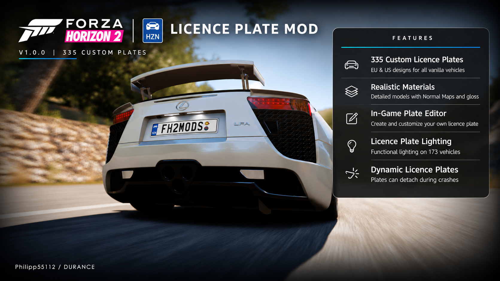

  

  <b>Custom Licence Plates for Forza Horizon 2 on PC</b>

  
  
  
  

# 🚘 Licence Plate Mod for Forza Horizon 2

Bring custom licence plates, realistic plate lighting and interactive customization to **Forza Horizon 2**!

The Licence Plate Mod replaces the original licence plates on 335 vanilla vehicles with custom HORIZON plates and introduces a fully integrated in-game editor. Customize your own plate, choose between European and US designs, and see your changes directly on your vehicle.

Your car gets its own identity – while Drivatars and traffic keep their HORIZON plates.

---

## ✨ Features

### 🚗 Custom Licence Plates

- Replaces the original licence plates on **335 vanilla vehicles**.
- Individual HORIZON licence plate models for every supported vehicle.
- European and US licence plate designs, selected to match the vehicle.
- Realistic embossed lettering using normal maps, gloss maps and detailed materials.
- Your own vehicle displays your custom licence plate.
- Drivatars and traffic retain their standard HORIZON licence plates.
- Your custom plate remains assigned to your vehicle, even after changing cars.
- Dedicated vehicle resources ensure that your custom plate also works when a Drivatar is driving the same vehicle model.

### 🖥️ In-Game Licence Plate Editor

Customize your licence plate directly from the Garage.

- Dedicated **Licence Plates** tile in the Garage.
- Up to 8 characters per plate.
- Supports A–Z, 0–9 and spaces.
- Live preview: changes are immediately visible on your vehicle while editing.
- Three European-themed plate stickers:
  - Blue
  - Turquoise
  - Gold
- Remove your licence plate directly from the editor.
- Restore the original HORIZON design at any time.
- Interface available in **16 languages**.

### 💡 Licence Plate Lighting

Functional licence plate lighting has been implemented for **173 vehicles**.

- Individual light sources for each licence plate lamp.
- Illuminated lamp lenses that activate with the vehicle's headlights.
- Vehicle-specific light colours, brightness and positioning.
- Individually adjusted light cones aimed at the licence plate.
- Light cone width adapts to the size of the original lamp.
- Supports different tuning bumpers and their respective lamp positions.
- Lighting follows the headlights, including headlights activated through Extra Options.

Only vehicles with actual, externally visible licence plate lights receive this feature.

### 💥 Dynamic Licence Plates

Licence plates can now physically detach during crashes!

- Works with both **Cosmetic** and **Simulation** damage.
- Plates detach when the damage threshold is reached.
- Realistic physics: detached plates tumble and fall onto the road.
- The plate shadow disappears when the plate is detached.
- Licence plates are automatically restored after repairing the vehicle.
- Only affects your own vehicle.

---

## 🚙 Vehicle Coverage

| Feature | Coverage |
|---|---:|
| Custom HORIZON licence plates | 335 vehicles |
| EU-style licence plates | 166 vehicles |
| US-style licence plates | 167 vehicles |
| Functional licence plate lighting | 173 vehicles |
| Vehicles without licence plates | 2 vehicles |

All 335 vehicle placements have been individually adjusted and visually checked.

The two unsupported vehicles also do not feature licence plates in subsequent Forza Horizon titles.

---

## 📦 Requirements

- Forza Horizon 2 – PC version
- Azimuth
- FH2 Extra Options
- Runtime mod loading enabled in Extra Options

---

## 📥 Installation

1. Download the latest release from the GitHub Releases page.
2. Extract the ZIP archive.
3. Copy the contents into your Forza Horizon 2 mod directory used by Extra Options.
4. Make sure runtime mod loading is enabled.
5. Launch the game.

The mod consists of the vehicle assets, UI files and the `PlateLight.dll` plugin.

---

## ⚙️ Configuration

The plugin configuration is located at:

`plugins\PlateLight.ini`

### Licence Plate Lighting

The `[Light]` section contains the lighting settings.

| Setting | Default | Description |
|---|---:|---|
| `On` | `1` | Enables or disables licence plate lighting. |
| `OnlyWithHeadlights` | `1` | Lighting follows the vehicle headlights. |
| `Brightness` | `0.45` | Overall light brightness. |
| `UseTable` | `1` | Uses the vehicle-specific lamp data. |
| `ConeByLampSize` | `1` | Adjusts the light cone according to lamp size. |

### Licence Plate

The `[Plate]` section contains the plate customization settings.

| Setting | Default | Description |
|---|---|---|
| `Text` | `HORIZON{0}` | Default licence plate text. |
| `Hidden` | `0` | Set to `1` to hide the licence plate. |
| `FallOffAt` | `0.3` | Damage threshold for the plate detachment. Set to `0` to disable this feature. |

**Note:** Custom text configured through the INI file instead of the in-game editor takes effect after restarting the game.

---

## ⚠️ Known Limitations

- Drivatars display the illuminated licence plate lamp lenses, but only the player's vehicle produces actual licence plate lighting.
- Only the player's vehicle supports physical licence plate detachment.
- The background lookup for the licence plate detachment system can take up to approximately 20 seconds after loading a vehicle.
- Vehicles without a suitable original licence plate mounting position or visible lighting cannot use the corresponding features.
- A game hang when leaving Photo Mode is currently under investigation. It has also been observed without other mods installed.

---

## 🛠️ Technical Details

The mod consists of custom vehicle assets and the `PlateLight.dll` plugin.

The plugin handles:

- Player vehicle identification.
- Custom licence plate generation and live updates.
- Individual vehicle licence plate resources.
- Licence plate lighting and tuning part detection.
- Licence plate removal and restoration.
- Physical licence plate detachment.

Custom plate textures are generated at runtime. Vehicle-specific resources are managed without creating an unlimited number of texture copies.

---

## ❤️ Credits

Created by **Philipp55112**.

Thank you to everyone who tested the mod, provided feedback and helped make this project possible!

---

## ⚖️ Disclaimer

Forza Horizon 2 and all related assets are the property of Microsoft and Playground Games.

This is an unofficial community modification and is not affiliated with, endorsed by or supported by Microsoft or Playground Games.

**Please do not redistribute modified versions of this project without permission.**
